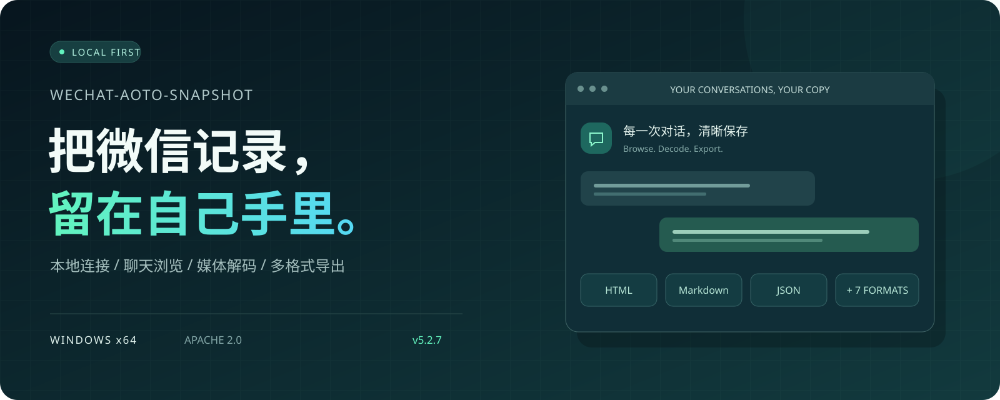
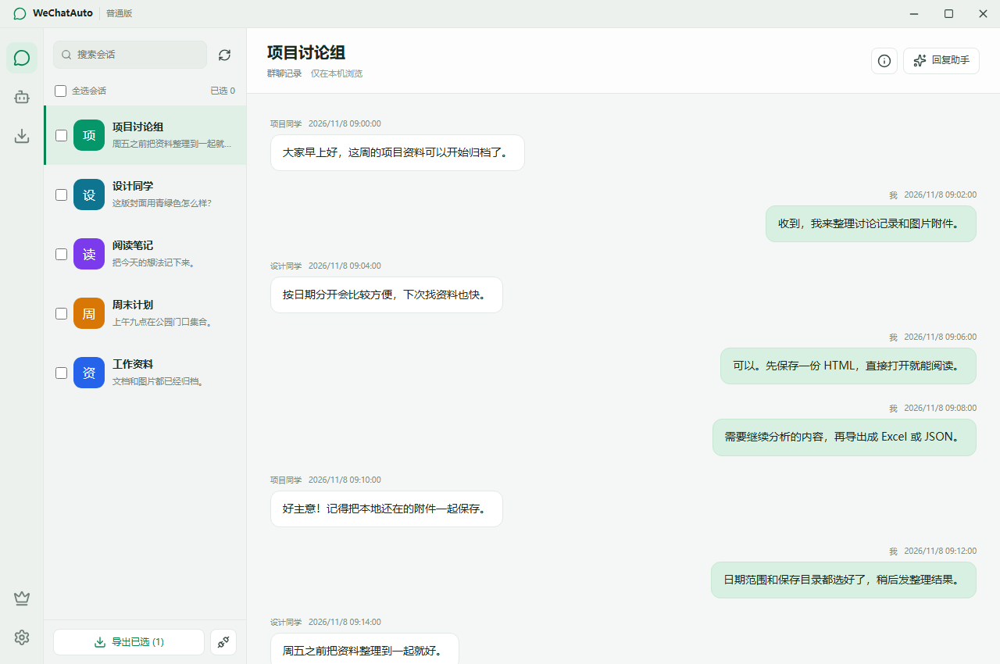
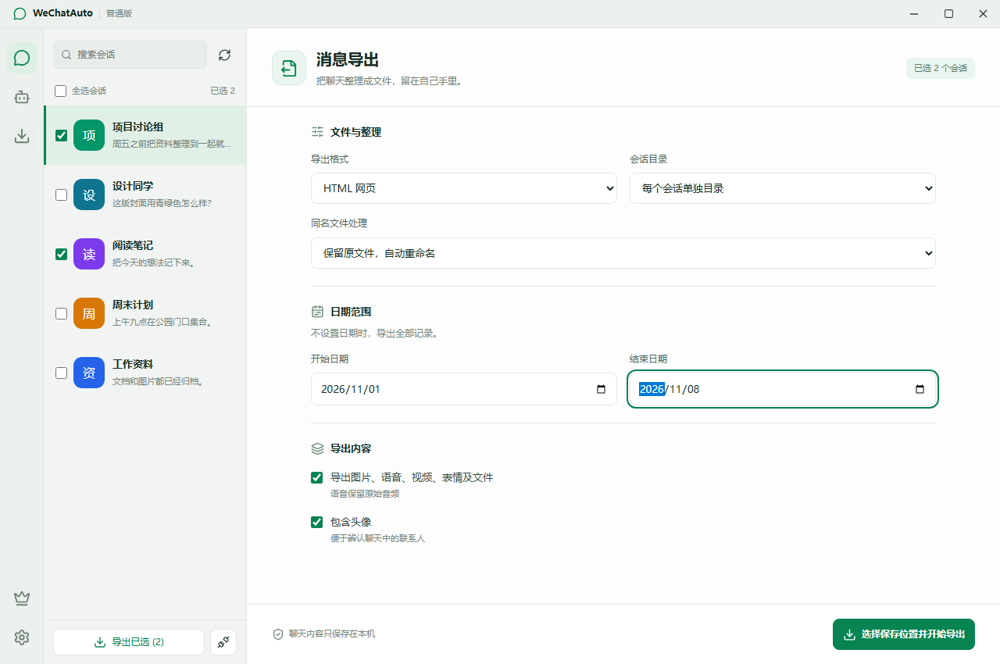

<p align="center"></p>

<h1 align="center">Wechat-aoto-snapshot</h1>
<p align="center"><strong>本地连接 · 聊天浏览 · 媒体解码 · 多格式导出</strong><br>Local-first WeChat history, decoded.</p>

<p align="center">
  <a href="https://github.com/Lay-quq/Wechat-aoto-snapshot/releases/latest"></a>
  <a href="LICENSE"></a>
  
  <a href="https://github.com/Lay-quq/Wechat-aoto-snapshot/actions/workflows/windows.yml"></a>
</p>

<p align="center"><a href="https://github.com/Lay-quq/Wechat-aoto-snapshot/releases/latest"><strong>下载 Windows 安装包</strong></a> · <a href="#快速开始">快速开始</a> · <a href="#从源码构建">从源码构建</a> · <a href="https://github.com/Lay-quq/Wechat-aoto-snapshot/issues">反馈问题</a></p>

---

## 让聊天记录真正可读、可用

连接本机已登录的微信，把会话、消息与附件整理成可以浏览、查阅和保存的资料。聊天处理在本机完成，无需注册应用账号。

| 能力 | 你可以做什么 |
| --- | --- |
| **一键连接** | 识别当前本机微信，连接过程支持取消；已有资料密码和 Windows Hello 继续生效。 |
| **顺畅浏览** | 搜索会话、切换联系人或群聊，分页读取历史消息。 |
| **媒体解码** | 查看本地图片、视频，解码和播放原始语音，随导出保存可获取的附件。 |
| **自由导出** | 选择会话与日期范围，设置附件和头像、目录布局与冲突策略，查看进度或取消导出。 |

### 一个记录，十种出口

**ChatLab · ChatLab JSONL · JSON · Arkme JSON · HTML · Markdown · TXT · Excel · WeClone CSV · PostgreSQL**

想直接阅读，选 HTML；想整理笔记，选 Markdown；想分析或继续开发，选 JSON、Excel 或 SQL。媒体能否导出取决于对应文件是否仍在本机可获取。

## 界面预览

<p></p>
<p align="center"><sub>聊天浏览 · 使用真实普通版组件渲染，全部为合成示例数据</sub></p>

<p></p>
<p align="center"><sub>按会话、日期和附件需求导出 · 示例数据</sub></p>

## 快速开始

1. 从 [Releases](https://github.com/Lay-quq/Wechat-aoto-snapshot/releases/latest) 下载 `WeChatAuto-standard-5.2.7-Setup.exe`，可用同页 `SHA256SUMS.txt` 核对文件。
2. 安装后保持微信已登录，打开 **WeChatAuto - 普通版**，点击“一键连接本机微信”。
3. 在会话列表浏览消息；勾选会话后进入“消息导出”，设置格式并选择保存目录。

**运行环境：** Windows x64；内置活动账号探测适配微信 **4.1.15.56**，其他版本需要另行验证。当前发行包未进行代码签名，Windows 可能显示未知发布者。请使用本仓库发布的安装包并核对摘要。

已有资料锁需要原密码或 Windows Hello 解锁。操作自己拥有或获准访问的资料，导出文件也可能包含敏感信息，请自行妥善保管。

## 从源码构建

准备 **Windows x64、Node.js 24 与 npm**，在全新目录执行：

```powershell
git clone https://github.com/Lay-quq/Wechat-aoto-snapshot.git
cd Wechat-aoto-snapshot
npm ci
npm run verify:source
npm run test:source
npm run typecheck
npm run build:compile
npm run build
```

安装包输出到独立的 `release-standard-*` 目录。构建不会覆盖现有安装或复制用户配置。源码可独立安装依赖和编译；原生组件以经过摘要校验的预编译文件随仓库提供，详见 [构建与原生组件](docs/build.md)。

`source-manifest.json` 记录发布快照的文件摘要。修改源码后校验失败是预期行为；发布新的源码快照时使用 `npm run export:source -- D:/your-new-snapshot` 重新生成清单。详情见 [贡献说明](CONTRIBUTING.md)。

## 许可证

Copyright 2026 Lay-quq。项目源码采用 [Apache License 2.0](LICENSE)。第三方组件按各自许可证分发，见 [NOTICE](NOTICE) 和 [第三方组件说明](docs/third-party.md)。

## 极客版：让 AI 在当前聊天里协助回复

极客版以聊天页面的 **回复助手** 为入口，把目标、联系人背景和回复风格放到同一次自动回复任务里。

| 能力 | 使用方式 |
| --- | --- |
| **自动回复** | 在当前聊天明确开启后，结合上下文生成并发送回复；支持原生引用和群聊 @。 |
| **目标与阶段计划** | 为沟通设置目标和阶段，让后续回复围绕同一任务推进。 |
| **联系人上下文与记忆** | 结合联系人标签、历史与选定参考会话组织背景，按设置补充图片理解。 |
| **Agent 与回复风格** | 在回复助手中选择 Agent、配置本人风格；人格提炼按会员权益开放。 |
| **模型与媒体配置** | 在配置中心接入模型供应商，管理独立图片理解与媒体能力，密钥由主进程保管。 |
| **可控的运行权限** | 按账号和聊天开启、停止；停止任务、锁屏、换号或重启会撤销相应发送权限。 |

使用极客版需要自行配置模型 API Key，模型调用的费用与额度由供应商决定。侧栏 AI Agent 用于配置，自动回复在聊天页面由机主开启。以上为已发行功能介绍，不包含尚未上线的声音建模、微信语音发送或电话能力。

---

当前仓库仅提供聊天消息解码相关能力，包括聊天浏览、媒体解码与记录导出。更多能力请加入 [Telegram 群组](https://t.me/+vT8nOpfiuOU4MWM1) 购买极客版。
